# 实验3：Android 界面组件实验报告

## 一、实验环境

### 1.1环境

Android Studio Rabbit 1 | 2026.2.1

五个任务分别放在独立 Activity 中，由 HomeActivity 统一启动。

### 1.2 导航页布局 activity_home.xml

1. 在 app/src/main/res/layout 中创建 activity_home.xml，根节点使用竖直 LinearLayout

2. 在布局顶部添加 TextView，用 layout_marginBottom 与下方按钮分开。

3. 每个按钮的宽度为 match_parent、高度为 wrap_content，黑底白字。将五个按钮的 ID 分别设置为 btn_task1～btn_task5

完整导航页 XML 如下：

[activity_home.xml](app/src/main/res/layout/activity_home.xml#L1)

```xml
<?xml version="1.0" encoding="utf-8"?>
<LinearLayout xmlns:android="http://schemas.android.com/apk/res/android"
    android:id="@+id/home_root"
    android:layout_width="match_parent"
    android:layout_height="match_parent"
    android:gravity="center_horizontal"
    android:orientation="vertical"
    android:padding="24dp">

    <TextView
        android:layout_width="wrap_content"
        android:layout_height="wrap_content"
        android:layout_marginBottom="24dp"
        android:text="实验3 导航页"
        android:textSize="22sp"
        android:textStyle="bold" />

    <Button
        android:id="@+id/btn_task1"
        android:layout_width="match_parent"
        android:layout_height="wrap_content"
        android:backgroundTint="@color/black"
        android:text="1. ListView"
        android:textColor="#FFFFFF" />

    <Button
        android:id="@+id/btn_task2"
        android:layout_width="match_parent"
        android:layout_height="wrap_content"
        android:backgroundTint="@color/black"
        android:text="2. AlertDialog"
        android:textColor="#FFFFFF" />

    <Button
        android:id="@+id/btn_task3"
        android:layout_width="match_parent"
        android:layout_height="wrap_content"
        android:backgroundTint="@color/black"
        android:text="3. XML菜单"
        android:textColor="#FFFFFF" />

    <Button
        android:id="@+id/btn_task4"
        android:layout_width="match_parent"
        android:layout_height="wrap_content"
        android:backgroundTint="@color/black"
        android:text="4. ActionMode 菜单"
        android:textColor="#FFFFFF" />

    <Button
        android:id="@+id/btn_task5"
        android:layout_width="match_parent"
        android:layout_height="wrap_content"
        android:backgroundTint="@color/black"
        android:text="5. RecyclerView 列表视图"
        android:textColor="#FFFFFF" />

</LinearLayout>
```

### 1.3 配置 HomeActivity

**1. 创建入口 Activity：**在 com.mobleapp.exp_03 包下建立 HomeActivity，继承 AppCompatActivity，重写 onCreate()，先调用父类方法，再调用 setContentView(R.layout.activity_home) 加载刚才的导航布局。

**2. 处理系统栏区域：** 调用 EdgeToEdge.enable(this)，再通过 home_root 设置 WindowInsets 监听器，从 systemBars() 获取状态栏、导航栏等区域的尺寸，并以 setPadding() 设置根布局的最终内边距，避免内容被系统栏覆盖。

**3. 取得按钮引用：** 在 setContentView() 之后使用 findViewById() 获取五个按钮；此时查找的控件来自 activity_home.xml，因此 Java 中的 ID 必须与布局中定义的 ID 一致。

**4. 绑定点击事件：** 为每个按钮设置 OnClickListener，通过 new Intent(this, 目标Activity.class) 构造显式 Intent，再调用 startActivity() 打开对应页面。

[HomeActivity.java](app/src/main/java/com/mobleapp/exp_03/HomeActivity.java#L1)

```java
package com.mobleapp.exp_03;

import android.content.Intent;
import android.os.Bundle;
import android.widget.Button;

import androidx.activity.EdgeToEdge;
import androidx.appcompat.app.AppCompatActivity;
import androidx.core.graphics.Insets;
import androidx.core.view.ViewCompat;
import androidx.core.view.WindowInsetsCompat;

public class HomeActivity extends AppCompatActivity {

    @Override
    protected void onCreate(Bundle savedInstanceState) {
        super.onCreate(savedInstanceState);
        EdgeToEdge.enable(this);
        setContentView(R.layout.activity_home);
        ViewCompat.setOnApplyWindowInsetsListener(findViewById(R.id.home_root), (v, insets) -> {
            Insets systemBars = insets.getInsets(WindowInsetsCompat.Type.systemBars());
            v.setPadding(systemBars.left, systemBars.top, systemBars.right, systemBars.bottom);
            return insets;
        });

        Button btnTask1 = findViewById(R.id.btn_task1);
        Button btnTask2 = findViewById(R.id.btn_task2);
        Button btnTask3 = findViewById(R.id.btn_task3);
        Button btnTask4 = findViewById(R.id.btn_task4);
        Button btnTask5 = findViewById(R.id.btn_task5);

        btnTask1.setOnClickListener(v ->
                startActivity(new Intent(this, MainActivity.class)));

        btnTask2.setOnClickListener(v ->
                startActivity(new Intent(this, DialogActivity.class)));

        btnTask3.setOnClickListener(v ->
                startActivity(new Intent(this, MenuActivity.class)));

        btnTask4.setOnClickListener(v ->
                startActivity(new Intent(this, ActionModeActivity.class)));

        btnTask5.setOnClickListener(v ->
                startActivity(new Intent(this, RecyclerViewActivity.class)));
    }


}
```

### 1.4 设置 AndroidManifest.xml

[AndroidManifest.xml](app/src/main/AndroidManifest.xml#L1)

```xml
<?xml version="1.0" encoding="utf-8"?>
<manifest xmlns:android="http://schemas.android.com/apk/res/android"
    xmlns:tools="http://schemas.android.com/tools">

    <uses-permission android:name="android.permission.POST_NOTIFICATIONS" />

    <application
        android:allowBackup="true"
        android:dataExtractionRules="@xml/data_extraction_rules"
        android:fullBackupContent="@xml/backup_rules"
        android:icon="@mipmap/ic_launcher"
        android:label="@string/app_name"
        android:roundIcon="@mipmap/ic_launcher_round"
        android:supportsRtl="true"
        android:theme="@style/Theme.Exp_03">
        <activity
            android:name=".HomeActivity"
            android:exported="true">
            <intent-filter>
                <action android:name="android.intent.action.MAIN" />
                <category android:name="android.intent.category.LAUNCHER" />
            </intent-filter>
        </activity>

        <activity
            android:name=".MainActivity"
            android:exported="false" />

        <activity
            android:name=".DialogActivity"
            android:exported="false"
            android:windowSoftInputMode="adjustResize" />

        <activity
            android:name=".MenuActivity"
            android:exported="false" />

        <activity
            android:name=".ActionModeActivity"
            android:exported="false" />

        <activity
            android:name=".RecyclerViewActivity"
            android:exported="false" />

    </application>

</manifest>
```

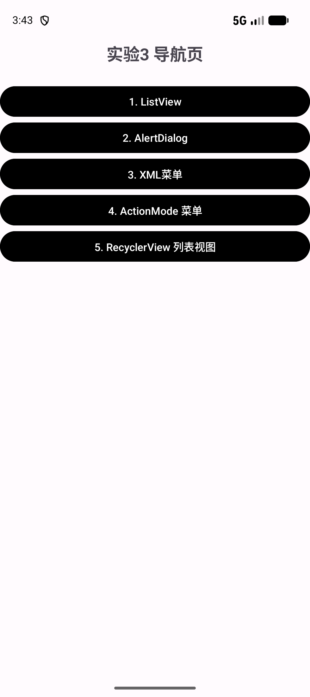

**图 1　运行应用后显示五个任务的导航入口**

## 二、Task1：使用 SimpleAdapter 实现 ListView

### 2.1 准备数据与列表容器

使用 Lion、Tiger、Monkey、Dog、Cat、Elephant 六组动物。名称数组与图标数组按相同顺序排列，后续用相同下标组合成一条记录。主布局放置占满可用区域的 ListView，并设置列表项分隔线。

[activity_main.xml](app/src/main/res/layout/activity_main.xml#L1)

```xml
<?xml version="1.0" encoding="utf-8"?>
<androidx.constraintlayout.widget.ConstraintLayout xmlns:android="http://schemas.android.com/apk/res/android"
    xmlns:app="http://schemas.android.com/apk/res-auto"
    xmlns:tools="http://schemas.android.com/tools"
    android:id="@+id/main"
    android:layout_width="match_parent"
    android:layout_height="match_parent"
    tools:context=".MainActivity">
    <!--Task_1-->
    <ListView
        android:id="@+id/list_view"
        android:layout_width="0dp"
        android:layout_height="0dp"
        android:choiceMode="singleChoice"
        android:divider="#CCCCCC"
        android:dividerHeight="1dp"
        app:layout_constraintBottom_toBottomOf="parent"
        app:layout_constraintEnd_toEndOf="parent"
        app:layout_constraintStart_toStartOf="parent"
        app:layout_constraintTop_toTopOf="parent" />

</androidx.constraintlayout.widget.ConstraintLayout>
```

### 2.2 定义每一行的布局

在 list_item.xml 中使用横向 LinearLayout

[list_item.xml](app/src/main/res/layout/list_item.xml#L1)

```xml
<?xml version="1.0" encoding="utf-8"?>
<LinearLayout xmlns:android="http://schemas.android.com/apk/res/android"
    android:layout_width="match_parent"
    android:layout_height="wrap_content"
    android:background="@drawable/item_bg"
    android:gravity="center_vertical"
    android:orientation="horizontal"
    android:paddingStart="12dp"
    android:paddingTop="8dp"
    android:paddingEnd="12dp"
    android:paddingBottom="8dp">

    <TextView
        android:id="@+id/tv_name"
        android:layout_width="0dp"
        android:layout_height="wrap_content"
        android:layout_weight="1"
        android:textColor="#222222"
        android:textSize="16sp" />

    <ImageView
        android:id="@+id/iv_icon"
        android:layout_width="48dp"
        android:layout_height="48dp"
        android:contentDescription="@null"
        android:scaleType="centerCrop" />

</LinearLayout>
```

### 2.3 构造 Map 设置 SimpleAdapter

遍历名称和图片数组，每条 Map 使用 name、icon 两个键。SimpleAdapter 的 from 数组按顺序指定源字段，to 数组按相同顺序指定目标控件， name → tv_name、icon → iv_icon。再调用 setAdapter() 链接列表和数据。

[MainActivity.java](app/src/main/java/com/mobleapp/exp_03/MainActivity.java#L53)

```java
        String[] names = {"Lion", "Tiger", "Monkey", "Dog", "Cat", "Elephant"};
        int[] icons = {
                R.drawable.lion,
                R.drawable.tiger,
                R.drawable.monkey,
                R.drawable.dog,
                R.drawable.cat,
                R.drawable.elephant
        };

        List<Map<String, Object>> data = new ArrayList<>();
        for (int i = 0; i < names.length; i++) {
            Map<String, Object> item = new HashMap<>();
            item.put("name", names[i]);
            item.put("icon", icons[i]);
            data.add(item);
        }

        SimpleAdapter adapter = new SimpleAdapter(
                this,
                data,
                R.layout.list_item,
                new String[]{"name", "icon"},
                new int[]{R.id.tv_name, R.id.iv_icon}
        );
        ListView listView = findViewById(R.id.list_view);
        listView.setAdapter(adapter);
```

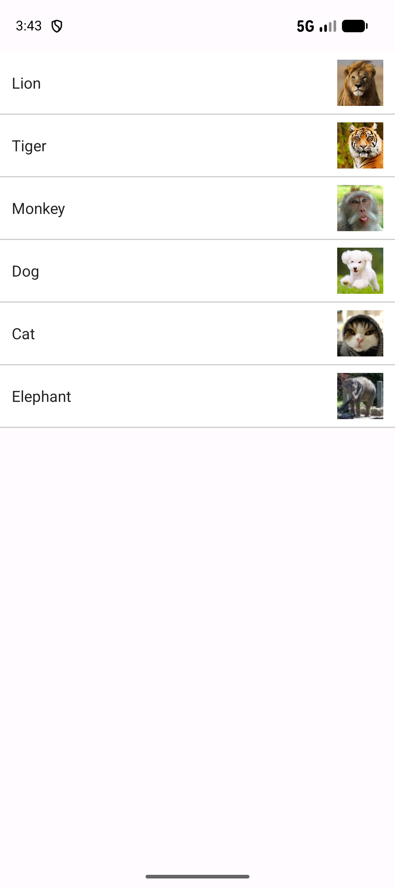

**图 2　六组动物名称和原图片通过 SimpleAdapter 显示到列表**

### 2.4 处理点击并发送通知

在 OnItemClickListener 中用 position 读取对应名称，先显示 Toast，再调用 sendNotification(name)。通知需要在 Manifest 声明 POST_NOTIFICATIONS 权限；模拟器是 API 37，需要授权。

Manifest 中的权限声明如下：

```xml
<uses-permission android:name="android.permission.POST_NOTIFICATIONS" />
```

[MainActivity.java](app/src/main/java/com/mobleapp/exp_03/MainActivity.java#L80)

```java
        listView.setOnItemClickListener((parent, view, position, id) -> {
            String name = names[position];
            Toast.makeText(this, name, Toast.LENGTH_LONG).show();
            sendNotification(name);
        });

    }

```

[MainActivity.java](app/src/main/java/com/mobleapp/exp_03/MainActivity.java#L88)

```java
    private void createNotificationChannel() {
        NotificationChannel channel = new NotificationChannel(
                CHANNEL_ID,
                "动物通知",
                NotificationManager.IMPORTANCE_DEFAULT
        );
        NotificationManager manager = getSystemService(NotificationManager.class);
        manager.createNotificationChannel(channel);
    }
```

[MainActivity.java](app/src/main/java/com/mobleapp/exp_03/MainActivity.java#L98)

```java
    private void requestNotificationPermission() {
        if (ContextCompat.checkSelfPermission(this, Manifest.permission.POST_NOTIFICATIONS)
                != PackageManager.PERMISSION_GRANTED) {
            ActivityCompat.requestPermissions(
                    this,
                    new String[]{Manifest.permission.POST_NOTIFICATIONS},
                    REQUEST_POST_NOTIFICATIONS
            );
        }
    }
```

[MainActivity.java](app/src/main/java/com/mobleapp/exp_03/MainActivity.java#L109)

```java
    private void sendNotification(String name) {
        if (ContextCompat.checkSelfPermission(this, Manifest.permission.POST_NOTIFICATIONS)
                != PackageManager.PERMISSION_GRANTED) {
            requestNotificationPermission();
            return;
        }
        Notification notification = new Notification.Builder(this, CHANNEL_ID)
                .setSmallIcon(R.mipmap.ic_launcher)
                .setLargeIcon(BitmapFactory.decodeResource(getResources(), R.mipmap.ic_launcher))
                .setContentTitle(name)
                .setAutoCancel(true)
                .build();
        NotificationManager manager = getSystemService(NotificationManager.class);
        manager.notify(name.hashCode(), notification);
    }
```

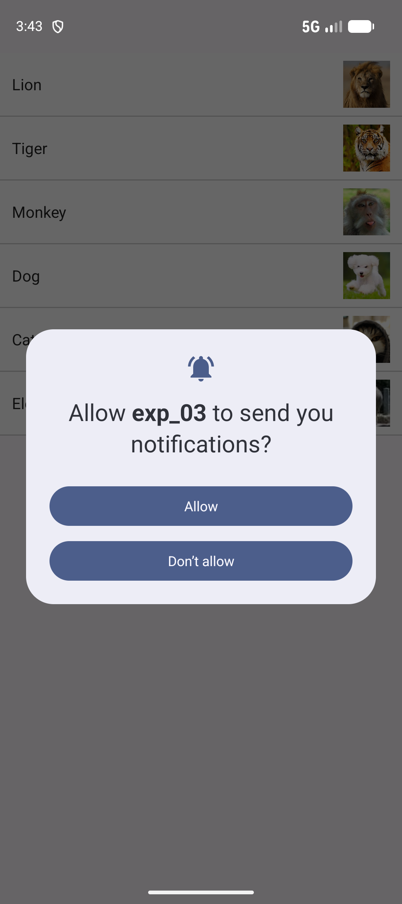

**图 3　首次进入时申请发送通知权限，授权后再点击列表项**

| 图 4：点击 Dog，Toast 显示 Dog | 图 5：展开系统通知栏，出现标题为 Dog 的通知 |
| --- | --- |
| 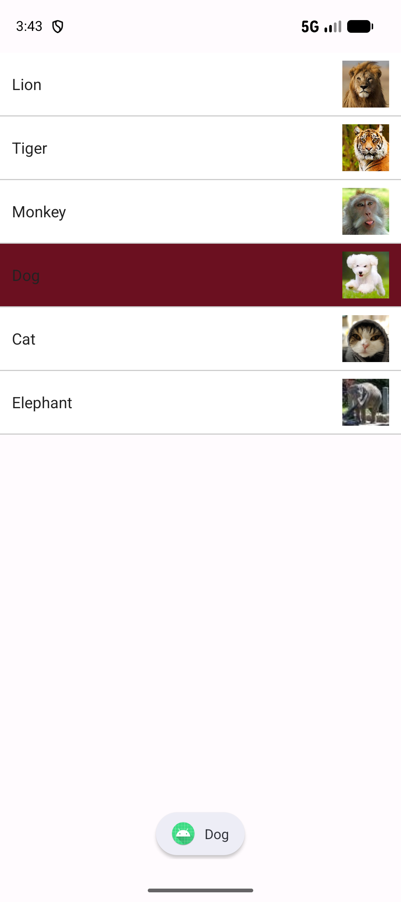 | 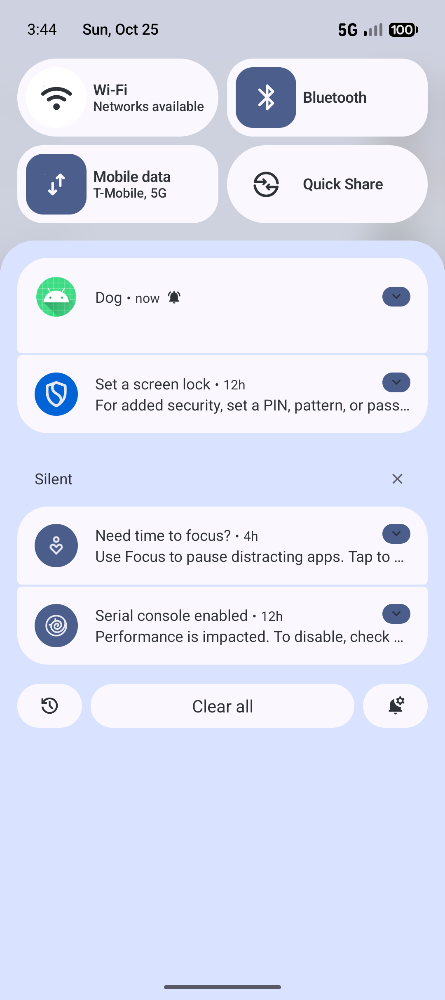 |

## 三、Task2：创建自定义布局的 AlertDialog

### 3.1 编写登录表单布局

dialog_login.xml 的根节点采用竖直 LinearLayout；用户名输入框设置 textPersonName，密码输入框设置 textPassword；底部用横向布局排列 Cancel 和 Sign in 两个等宽按钮。

[dialog_login.xml](app/src/main/res/layout/dialog_login.xml#L1)

```xml
<?xml version="1.0" encoding="utf-8"?>
<LinearLayout xmlns:android="http://schemas.android.com/apk/res/android"
    android:layout_width="match_parent"
    android:layout_height="wrap_content"
    android:background="#FFFFFF"
    android:orientation="vertical">

    <TextView
        android:layout_width="match_parent"
        android:layout_height="wrap_content"
        android:background="#FFB300"
        android:gravity="center"
        android:padding="16dp"
        android:text="ANDROID APP"
        android:textColor="#FFFFFF"
        android:textSize="22sp"
        android:textStyle="bold" />

    <EditText
        android:id="@+id/et_username"
        android:layout_width="match_parent"
        android:layout_height="wrap_content"
        android:hint="Username"
        android:inputType="textPersonName"
        android:padding="16dp" />

    <EditText
        android:id="@+id/et_password"
        android:layout_width="match_parent"
        android:layout_height="wrap_content"
        android:hint="Password"
        android:inputType="textPassword"
        android:padding="16dp" />

    <View
        android:layout_width="match_parent"
        android:layout_height="1dp"
        android:background="#CCCCCC" />

    <LinearLayout
        android:layout_width="match_parent"
        android:layout_height="48dp"
        android:orientation="horizontal">

        <Button
            android:id="@+id/btn_cancel"
            style="?android:attr/borderlessButtonStyle"
            android:layout_width="0dp"
            android:layout_height="match_parent"
            android:layout_weight="1"
            android:text="Cancel"
            android:textColor="@color/black"
            android:textAllCaps="false" />

        <View
            android:layout_width="1dp"
            android:layout_height="match_parent"
            android:background="#CCCCCC" />

        <Button
            android:id="@+id/btn_sign_in"
            style="?android:attr/borderlessButtonStyle"
            android:layout_width="0dp"
            android:layout_height="match_parent"
            android:layout_weight="1"
            android:text="Sign in"
            android:textColor="@color/black"
            android:textAllCaps="false" />
    </LinearLayout>
</LinearLayout>
```

### 3.2 加载布局并创建对话框

DialogActivity 的 onCreate() 设置底层布局后，调用 showLoginDialog()。使用 LayoutInflater.inflate() 将 XML 转为 View；从 dialogView 查找输入框和按钮，然后把 dialogView 传给 Builder.setView()，调用 create() 创建对象，最后调用 show() 显示。

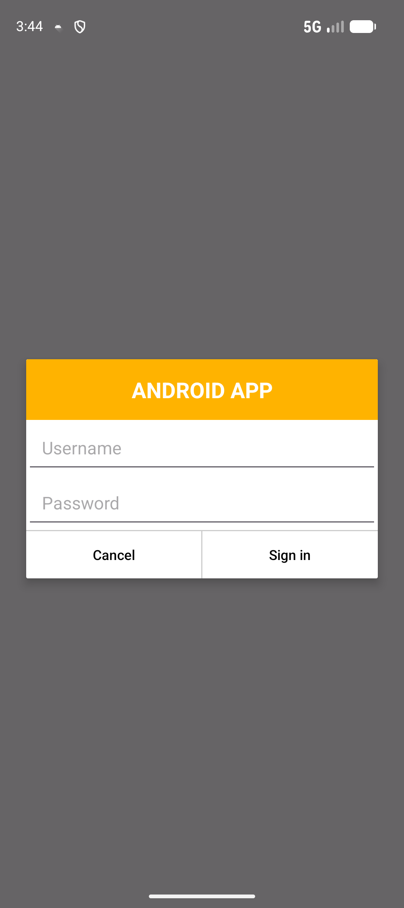

**图 6：进入页面，显示自定义登录对话框**

## 四、Task3：使用 XML 定义菜单

### 4.1 准备 Toolbar 和测试文字

activity_menu.xml 由 Toolbar 和 TextView 组成。Toolbar 作为菜单载体；TextView 初始为黑色，包含三行测试文字。Activity 中调用 setSupportActionBar(toolbar) 把 Toolbar 接入 AppCompat ，并保存 tv_test 引用用于修改显示属性。

[activity_menu.xml](app/src/main/res/layout/activity_menu.xml#L1)

```xml
<?xml version="1.0" encoding="utf-8"?>
<LinearLayout xmlns:android="http://schemas.android.com/apk/res/android"
    xmlns:app="http://schemas.android.com/apk/res-auto"
    android:id="@+id/menu_root"
    android:layout_width="match_parent"
    android:layout_height="match_parent"
    android:orientation="vertical">

    <androidx.appcompat.widget.Toolbar
        android:id="@+id/toolbar"
        android:layout_width="match_parent"
        android:layout_height="?attr/actionBarSize"
        android:background="?attr/colorPrimary"
        app:title="MenuTest" />

    <TextView
        android:id="@+id/tv_test"
        android:layout_width="match_parent"
        android:layout_height="wrap_content"
        android:padding="16dp"
        android:text="这是一段测试文字。\n这是一段测试文字。\n这是一段测试文字。"
        android:textColor="#000000"
        android:textSize="16sp" />

</LinearLayout>
```

[MenuActivity.java](app/src/main/java/com/mobleapp/exp_03/MenuActivity.java#L33)

```java
        Toolbar toolbar = findViewById(R.id.toolbar);
        setSupportActionBar(toolbar);
        tvTest = findViewById(R.id.tv_test);
```

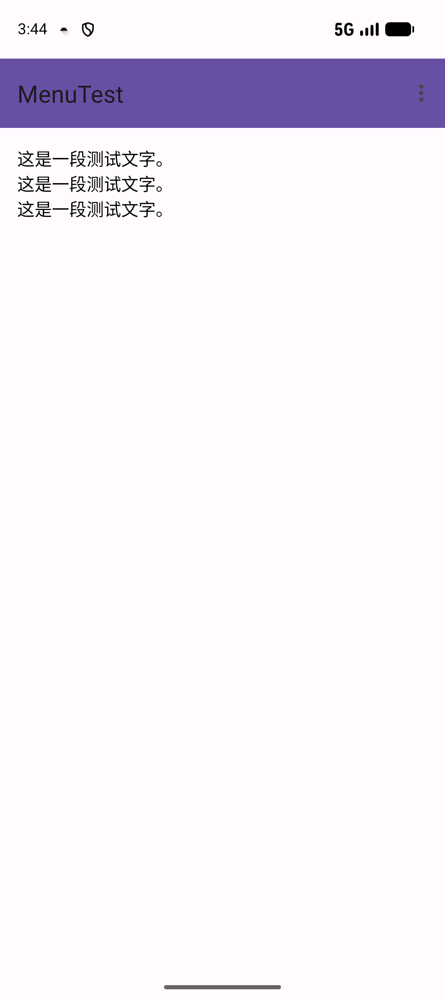

**图 7　菜单实验初始界面：16sp 黑色测试文字**

### 4.2 在 res/menu 中定义菜单和子菜单

main_menu.xml 以 menu 为根节点。字体大小、字体颜色两个 item 中分别嵌套 menu，形成两组子菜单；普通菜单项位于一级菜单

[main_menu.xml](app/src/main/res/menu/main_menu.xml#L1)

```xml
<?xml version="1.0" encoding="utf-8"?>
<menu xmlns:android="http://schemas.android.com/apk/res/android">

    <item
        android:id="@+id/menu_font_size"
        android:title="字体大小">
        <menu>
            <item
                android:id="@+id/size_small"
                android:title="小" />
            <item
                android:id="@+id/size_medium"
                android:title="中" />
            <item
                android:id="@+id/size_large"
                android:title="大" />
        </menu>
    </item>

    <item
        android:id="@+id/menu_normal"
        android:title="普通菜单项" />

    <item
        android:id="@+id/menu_font_color"
        android:title="字体颜色">
        <menu>
            <item
                android:id="@+id/color_red"
                android:title="红色" />
            <item
                android:id="@+id/color_black"
                android:title="黑色" />
        </menu>
    </item>

</menu>
```

| 图 8：点击右上角溢出按钮，打开三个一级菜单项 | 图 9：进入字体大小子菜单，显示小、中、大 |
| --- | --- |
| 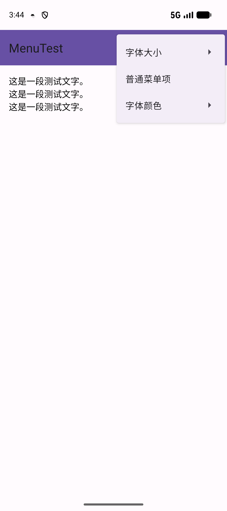 | 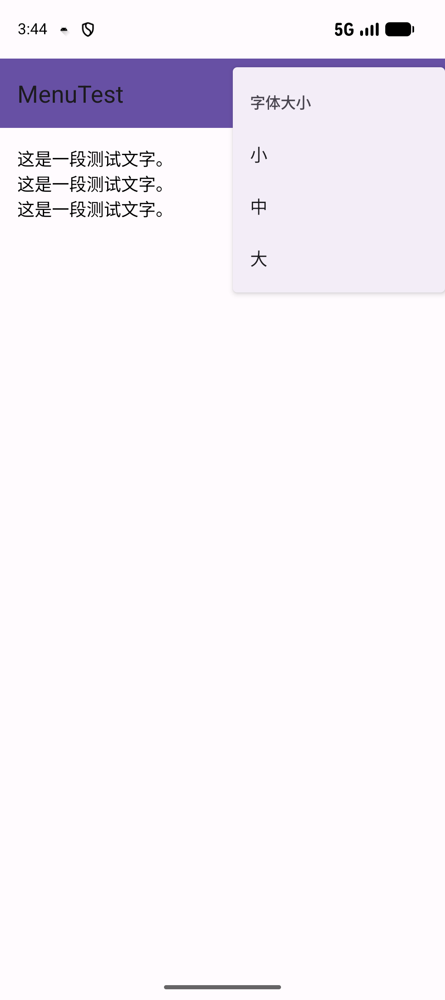 |

### 4.3 加载菜单并分发事件

重写 onCreateOptionsMenu()，调用 getMenuInflater().inflate()。系统回调 onOptionsItemSelected() 后，根据 item.getItemId() 分别处理字号、Toast 或颜色。字号使用 TypedValue.COMPLEX_UNIT_SP，分别设置为 10、16、20；颜色通过 Color.RED、Color.BLACK 设置。处理成功返回 true，其余菜单事件交由父类处理。

[MenuActivity.java](app/src/main/java/com/mobleapp/exp_03/MenuActivity.java#L39)

```java
    public boolean onCreateOptionsMenu(Menu menu) {
        getMenuInflater().inflate(R.menu.main_menu, menu);
        return true;
    }
```

[MenuActivity.java](app/src/main/java/com/mobleapp/exp_03/MenuActivity.java#L45)

```java
    public boolean onOptionsItemSelected(MenuItem item) {
        int id = item.getItemId();
        if (id == R.id.size_small) {
            tvTest.setTextSize(TypedValue.COMPLEX_UNIT_SP, 10);
            return true;
        } else if (id == R.id.size_medium) {
            tvTest.setTextSize(TypedValue.COMPLEX_UNIT_SP, 16);
            return true;
        } else if (id == R.id.size_large) {
            tvTest.setTextSize(TypedValue.COMPLEX_UNIT_SP, 20);
            return true;
        } else if (id == R.id.menu_normal) {
            Toast.makeText(this, "你点击了普通菜单项", Toast.LENGTH_SHORT).show();
            return true;
        } else if (id == R.id.color_red) {
            tvTest.setTextColor(Color.RED);
            return true;
        } else if (id == R.id.color_black) {
            tvTest.setTextColor(Color.BLACK);
            return true;
        }
        return super.onOptionsItemSelected(item);
    }
```

### 4.4 依次检查三种字号

依次选择“字体大小 → 小”“字体大小 → 中”“字体大小 → 大”，观察同一段文字的显示差异。

| 图 10：小：10sp | 图 11：中：16sp | 图 12：大：20sp |
| --- | --- | --- |
| 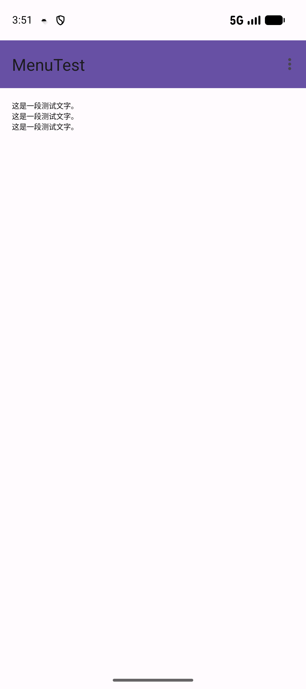 |  |  |

### 4.5 检查颜色和普通菜单项

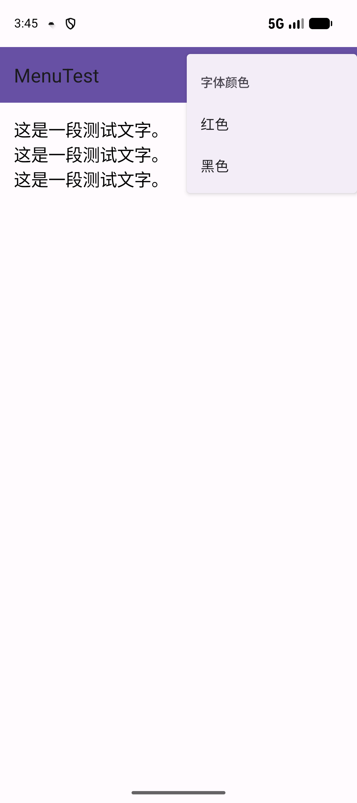

**图 13　字体颜色子菜单包含红色和黑色**

| 图 14：选择红色，测试文字变红 | 图 15：选择黑色，测试文字恢复黑色 | 图 16：普通菜单项触发“你点击了普通菜单项” |
| --- | --- | --- |
| 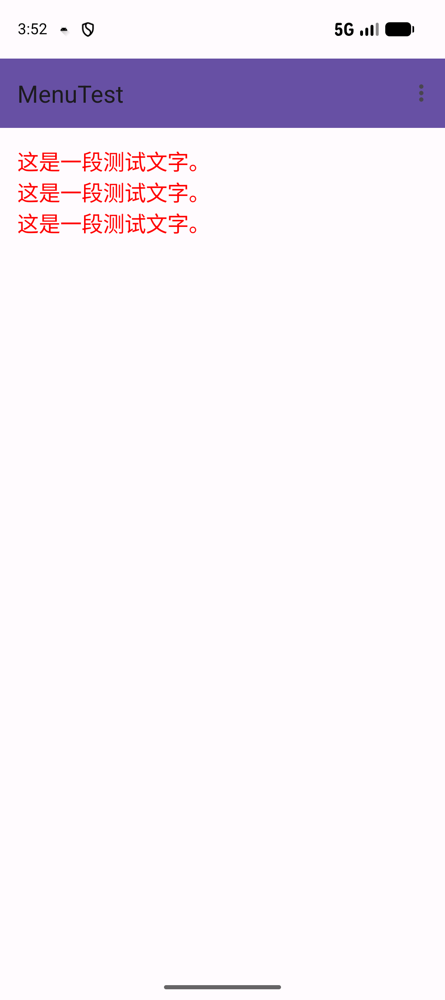 | 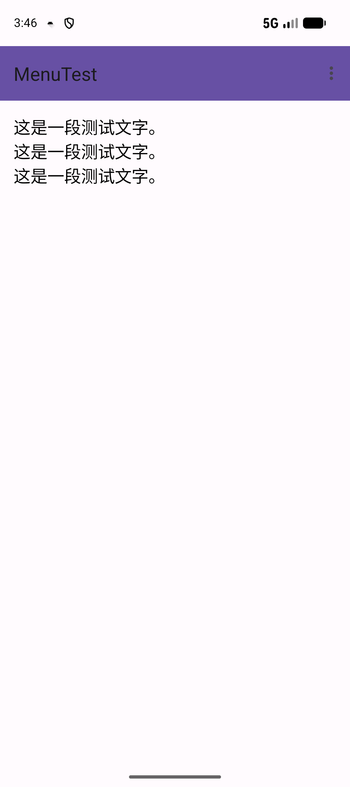 | 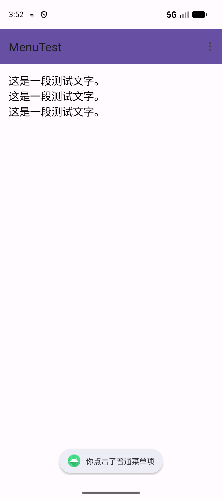 |

## 五、Task4：创建 ActionMode 上下文操作菜单

### 5.1 定义列表布局与选中背景

主页面包含 Toolbar、操作提示、ListView 和空列表提示。列表行左侧使用应用图标，右侧显示 One～Six。将选中状态写在独立 selector 中，使用 state_activated 响应 ListView 的勾选激活状态。

[activity_action_mode.xml](app/src/main/res/layout/activity_action_mode.xml#L1)

```xml
<?xml version="1.0" encoding="utf-8"?>
<LinearLayout xmlns:android="http://schemas.android.com/apk/res/android"
    xmlns:app="http://schemas.android.com/apk/res-auto"
    android:id="@+id/action_mode_root"
    android:layout_width="match_parent"
    android:layout_height="match_parent"
    android:orientation="vertical">

    <androidx.appcompat.widget.Toolbar
        android:id="@+id/action_mode_toolbar"
        android:layout_width="match_parent"
        android:layout_height="?attr/actionBarSize"
        android:background="?attr/colorPrimaryContainer"
        app:title="@string/action_mode_title" />

    <TextView
        android:layout_width="match_parent"
        android:layout_height="wrap_content"
        android:padding="16dp"
        android:text="@string/action_mode_hint" />

    <ListView
        android:id="@+id/action_list"
        android:layout_width="match_parent"
        android:layout_height="0dp"
        android:layout_weight="1"
        android:divider="?android:attr/listDivider"
        android:dividerHeight="1dp" />

    <TextView
        android:id="@+id/action_empty"
        android:layout_width="match_parent"
        android:layout_height="wrap_content"
        android:gravity="center"
        android:padding="24dp"
        android:text="@string/empty_action_list"
        android:visibility="gone" />
</LinearLayout>
```

[action_list_item.xml](app/src/main/res/layout/action_list_item.xml#L1)

```xml
<?xml version="1.0" encoding="utf-8"?>
<LinearLayout xmlns:android="http://schemas.android.com/apk/res/android"
    android:layout_width="match_parent"
    android:layout_height="wrap_content"
    android:background="@drawable/action_item_background"
    android:gravity="center_vertical"
    android:minHeight="72dp"
    android:orientation="horizontal"
    android:padding="12dp">

    <ImageView
        android:id="@+id/action_icon"
        android:layout_width="48dp"
        android:layout_height="48dp"
        android:layout_marginEnd="16dp"
        android:contentDescription="@null" />

    <TextView
        android:id="@+id/action_name"
        android:layout_width="0dp"
        android:layout_height="wrap_content"
        android:layout_weight="1"
        android:textSize="16sp" />
</LinearLayout>
```

[action_item_background.xml](app/src/main/res/drawable/action_item_background.xml#L1)

```xml
<?xml version="1.0" encoding="utf-8"?>
<selector xmlns:android="http://schemas.android.com/apk/res/android">
    <item android:state_activated="true" android:drawable="@color/action_item_selected" />
    <item android:state_pressed="true" android:drawable="@color/action_item_selected" />
    <item android:drawable="@android:color/transparent" />
</selector>
```


**图 17　操作前显示 One、Two、Three、Four、Five、Six 六条记录**

### 5.2 准备数据、适配器和 XML 操作菜单

把列表名称和应用图标组合为 Map 数据，使用 SimpleAdapter 加载行布局。删除按钮定义在 action_mode_menu.xml，使用独立 action_delete ID 和垃圾桶图标；AppCompat 菜单使用 app:showAsAction。

[ActionModeActivity.java](app/src/main/java/com/mobleapp/exp_03/ActionModeActivity.java#L43)

```java
        if (savedInstanceState == null) {
            names.addAll(Arrays.asList("One", "Two", "Three", "Four", "Five", "Six"));
        } else {
            names.addAll(savedInstanceState.getStringArrayList("names"));
        }
        List<Map<String, Object>> data = new ArrayList<>();
        for (String name : names) {
            Map<String, Object> item = new HashMap<>();
            item.put("name", name);
            item.put("icon", R.mipmap.ic_launcher);
            data.add(item);
        }
        SimpleAdapter adapter = new SimpleAdapter(this, data, R.layout.action_list_item,
                new String[]{"name", "icon"}, new int[]{R.id.action_name, R.id.action_icon});
        ListView listView = findViewById(R.id.action_list);
        listView.setAdapter(adapter);
        listView.setEmptyView(findViewById(R.id.action_empty));

```

[action_mode_menu.xml](app/src/main/res/menu/action_mode_menu.xml#L1)

```xml
<?xml version="1.0" encoding="utf-8"?>
<menu xmlns:android="http://schemas.android.com/apk/res/android"
    xmlns:app="http://schemas.android.com/apk/res-auto">
    <item
        android:id="@+id/action_delete"
        android:icon="@drawable/ic_delete"
        android:title="@string/delete_selected"
        app:showAsAction="ifRoom" />
</menu>
```

### 5.3 启用模态多选并实现回调

先调用 setChoiceMode(ListView.CHOICE_MODE_MULTIPLE_MODAL)，再注册 MultiChoiceModeListener。

[ActionModeActivity.java](app/src/main/java/com/mobleapp/exp_03/ActionModeActivity.java#L62)

```java
        listView.setChoiceMode(ListView.CHOICE_MODE_MULTIPLE_MODAL);
        listView.setMultiChoiceModeListener(new AbsListView.MultiChoiceModeListener() {
            @Override
            public void onItemCheckedStateChanged(ActionMode mode, int position,
                                                  long id, boolean checked) {
                int count = listView.getCheckedItemCount();
                mode.setTitle(getResources().getQuantityString(R.plurals.selected_count, count, count));
                if (count == 0) mode.finish();
            }

            @Override
            public boolean onCreateActionMode(ActionMode mode, Menu menu) {
                mode.getMenuInflater().inflate(R.menu.action_mode_menu, menu);
                int count = listView.getCheckedItemCount();
                mode.setTitle(getResources().getQuantityString(R.plurals.selected_count, count, count));
                toolbar.setVisibility(View.GONE);
                return true;
            }

            @Override
            public boolean onPrepareActionMode(ActionMode mode, Menu menu) {
                return false;
            }

            @Override
            public boolean onActionItemClicked(ActionMode mode, MenuItem item) {
                if (item.getItemId() != R.id.action_delete) return false;
                SparseBooleanArray checked = listView.getCheckedItemPositions();
                int count = listView.getCheckedItemCount();
                // Delete backwards so removing a row never changes remaining checked indices.
                for (int i = data.size() - 1; i >= 0; i--) {
                    if (checked.get(i)) {
                        data.remove(i);
                        names.remove(i);
                    }
                }
                mode.finish();
                adapter.notifyDataSetChanged();
                Toast.makeText(ActionModeActivity.this,
                        getString(R.string.deleted_count, count), Toast.LENGTH_SHORT).show();
                return true;
            }

            @Override
            public void onDestroyActionMode(ActionMode mode) {
                // ListView clears checked states when its modal ActionMode finishes.
                toolbar.setVisibility(View.VISIBLE);
            }
        });
    }

```

| 图 18：selected | 图 19：selected |
| --- | --- |
| 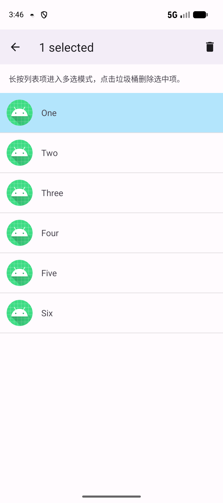 | 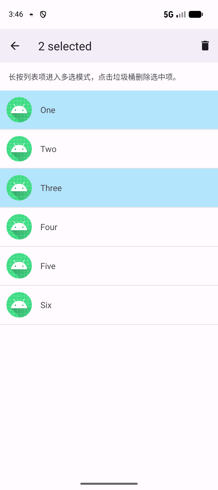 |

### 5.4 检查批量删除与取消

在 One、Three 同时选中时点击垃圾桶，检查只删除这两项，保留 Two、Four、Five、Six。随后重新进入，长按 Two，再按返回键退出模式；重新进入会初始化六条数据。

| 图 20：删除选中 | 图 21：重新进入 |
| --- | --- |
| 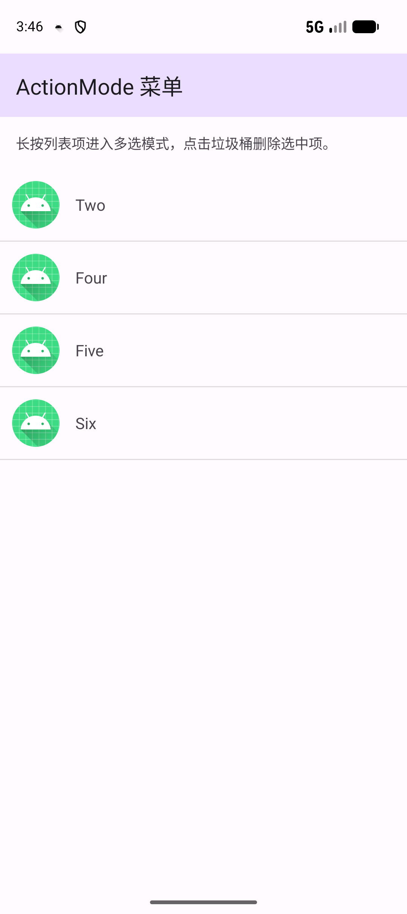 | 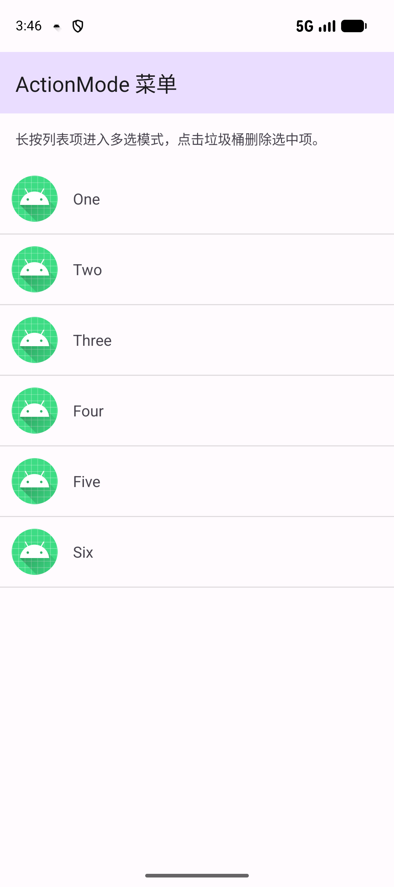 |

## 六、Task5：使用 RecyclerView 实现列表视图

### 6.1 添加依赖

在版本目录中声明 RecyclerView 1.4.0 和 CardView 1.0.0，并在 app 模块的 dependencies 中显式引用。其余实现沿用工程的 Java 和 XML 结构。

[libs.versions.toml](gradle/libs.versions.toml#L10)

```toml
recyclerview = "1.4.0"
cardview = "1.0.0"
```

app 模块中的对应依赖为：

```kotlin
implementation(libs.recyclerview)
implementation(libs.cardview)
```

### 6.2 定义数据对象与卡片行布局

animal_card_item.xml 以 CardView 为根容器；内部用横向布局排列 80dp 图片与名称。可点击与焦点属性放在整个卡片上，使点击区域覆盖整行。

[Animal.java](app/src/main/java/com/mobleapp/exp_03/Animal.java#L1)

```java
package com.mobleapp.exp_03;

public class Animal {
    public final String name;
    public final int imageResId;

    public Animal(String name, int imageResId) {
        this.name = name;
        this.imageResId = imageResId;
    }
}
```

[animal_card_item.xml](app/src/main/res/layout/animal_card_item.xml#L1)

```xml
<?xml version="1.0" encoding="utf-8"?>
<androidx.cardview.widget.CardView xmlns:android="http://schemas.android.com/apk/res/android"
    xmlns:app="http://schemas.android.com/apk/res-auto"
    android:layout_width="match_parent"
    android:layout_height="wrap_content"
    android:layout_margin="8dp"
    android:clickable="true"
    android:focusable="true"
    android:foreground="?android:attr/selectableItemBackground"
    app:cardCornerRadius="4dp"
    app:cardElevation="2dp">

    <LinearLayout
        android:layout_width="match_parent"
        android:layout_height="wrap_content"
        android:gravity="center_vertical"
        android:orientation="horizontal"
        android:padding="12dp">

        <ImageView
            android:id="@+id/animal_image"
            android:layout_width="80dp"
            android:layout_height="80dp"
            android:contentDescription="@null"
            android:scaleType="centerCrop" />

        <TextView
            android:id="@+id/animal_name"
            android:layout_width="0dp"
            android:layout_height="wrap_content"
            android:layout_marginStart="20dp"
            android:layout_weight="1"
            android:textSize="18sp" />
    </LinearLayout>
</androidx.cardview.widget.CardView>
```

### 6.3 编写 Adapter 和 ViewHolder

ViewHolder 缓存 TextView 和 ImageView，避免每次绑定重复查找。点击时通过 getBindingAdapterPosition() 读取当前有效位置

[AnimalAdapter.java](app/src/main/java/com/mobleapp/exp_03/AnimalAdapter.java#L1)

```java
package com.mobleapp.exp_03;

import android.view.LayoutInflater;
import android.view.View;
import android.view.ViewGroup;
import android.widget.ImageView;
import android.widget.TextView;
import android.widget.Toast;

import androidx.annotation.NonNull;
import androidx.recyclerview.widget.RecyclerView;

import java.util.List;

public class AnimalAdapter extends RecyclerView.Adapter<AnimalAdapter.AnimalViewHolder> {
    private final List<Animal> animals;

    public AnimalAdapter(List<Animal> animals) {
        this.animals = animals;
    }

    @NonNull
    @Override
    public AnimalViewHolder onCreateViewHolder(@NonNull ViewGroup parent, int viewType) {
        View view = LayoutInflater.from(parent.getContext())
                .inflate(R.layout.animal_card_item, parent, false);
        return new AnimalViewHolder(view);
    }

    @Override
    public void onBindViewHolder(@NonNull AnimalViewHolder holder, int position) {
        Animal animal = animals.get(position);
        holder.name.setText(animal.name);
        holder.image.setImageResource(animal.imageResId);
        holder.image.setContentDescription(animal.name);
    }

    @Override
    public int getItemCount() {
        return animals.size();
    }

    public class AnimalViewHolder extends RecyclerView.ViewHolder {
        final TextView name;
        final ImageView image;

        AnimalViewHolder(View itemView) {
            super(itemView);
            name = itemView.findViewById(R.id.animal_name);
            image = itemView.findViewById(R.id.animal_image);
            itemView.setOnClickListener(v -> {
                // Read the current position after recycling or insertion, not a cached bind position.
                int position = getBindingAdapterPosition();
                if (position != RecyclerView.NO_POSITION) {
                    Toast.makeText(v.getContext(), animals.get(position).name,
                            Toast.LENGTH_SHORT).show();
                }
            });
        }
    }
}
```

### 6.4 创建主布局并连接 LayoutManager

主页面上方显示标题、当前记录数量和新增按钮，下方 RecyclerView 使用剩余空间。LinearLayoutManager 负责纵向排列，Adapter 负责把 Animal 数据绑定到每行。

[activity_recycler_view.xml](app/src/main/res/layout/activity_recycler_view.xml#L1)

```xml
<?xml version="1.0" encoding="utf-8"?>
<LinearLayout xmlns:android="http://schemas.android.com/apk/res/android"
    xmlns:app="http://schemas.android.com/apk/res-auto"
    android:id="@+id/recycler_root"
    android:layout_width="match_parent"
    android:layout_height="match_parent"
    android:orientation="vertical">

    <androidx.appcompat.widget.Toolbar
        android:id="@+id/recycler_toolbar"
        android:layout_width="match_parent"
        android:layout_height="?attr/actionBarSize"
        android:background="?attr/colorPrimaryContainer"
        app:title="@string/recycler_view_title" />

    <TextView
        android:id="@+id/animal_count"
        android:layout_width="match_parent"
        android:layout_height="wrap_content"
        android:padding="16dp"
        android:textSize="16sp" />

    <Button
        android:id="@+id/btn_add_animal"
        android:layout_width="match_parent"
        android:layout_height="wrap_content"
        android:layout_marginStart="16dp"
        android:layout_marginEnd="16dp"
        android:backgroundTint="@color/black"
        android:text="@string/add_animal"
        android:textColor="@color/white" />

    <androidx.recyclerview.widget.RecyclerView
        android:id="@+id/animal_list"
        android:layout_width="match_parent"
        android:layout_height="0dp"
        android:layout_weight="1"
        android:clipToPadding="false"
        android:padding="8dp"
        android:scrollbars="vertical" />
</LinearLayout>
```

[RecyclerViewActivity.java](app/src/main/java/com/mobleapp/exp_03/RecyclerViewActivity.java#L38)

```java
        if (savedInstanceState == null) {
            for (int i = 0; i < names.length; i++) animalTypes.add(i);
        } else {
            animalTypes.addAll(savedInstanceState.getIntegerArrayList("animalTypes"));
        }
        List<Animal> animals = new ArrayList<>();
        for (int type : animalTypes) animals.add(new Animal(names[type], images[type]));
        AnimalAdapter adapter = new AnimalAdapter(animals);
        RecyclerView recyclerView = findViewById(R.id.animal_list);
        recyclerView.setLayoutManager(new LinearLayoutManager(this));
        recyclerView.setAdapter(adapter);
        TextView count = findViewById(R.id.animal_count);
        count.setText(getString(R.string.animal_count, animals.size()));

```

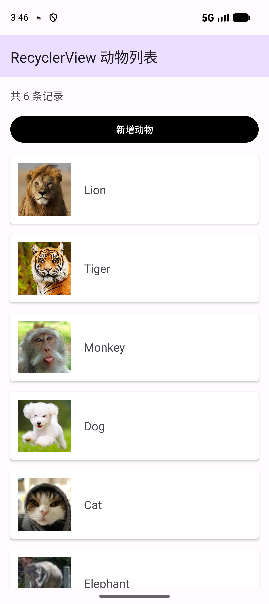

**图 22　初始共六条记录，显示原动物名称与图片**

### 6.5 增加一条记录并立即更新

点击新增按钮后，使用 AlertDialog.setItems() 显示六种动物名称。选中一种动物后，按以下顺序：

1. 用当前 animals.size() 取得插入位置。
2. 向数据列表添加对应名称和图片的 Animal，同时保存动物类型编号。
3. 调用 notifyItemInserted(position)，通知 RecyclerView 新增一条记录。
4. 更新“共 N 条记录”的文字。
5. scrollToPosition(position)，让新记录出现在可见区域。

[RecyclerViewActivity.java](app/src/main/java/com/mobleapp/exp_03/RecyclerViewActivity.java#L52)

```java
        findViewById(R.id.btn_add_animal).setOnClickListener(v ->
                new AlertDialog.Builder(this)
                        .setTitle(R.string.choose_animal)
                        .setItems(names, (dialog, which) -> {
                            int position = animals.size();
                            animals.add(new Animal(names[which], images[which]));
                            animalTypes.add(which);
                            adapter.notifyItemInserted(position);
                            count.setText(getString(R.string.animal_count, animals.size()));
                            recyclerView.scrollToPosition(position);
                        })
                        .setNegativeButton(R.string.cancel, null)
                        .show());
    }

```

| 图 23：点击新增动物，弹出六种动物的选择框 | 图 24：选择 Cat 后，共七条记录并显示末尾新增卡片 |
| --- | --- |
| 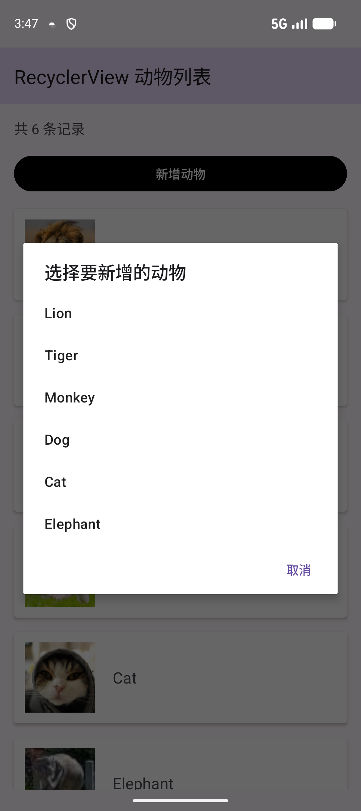 | 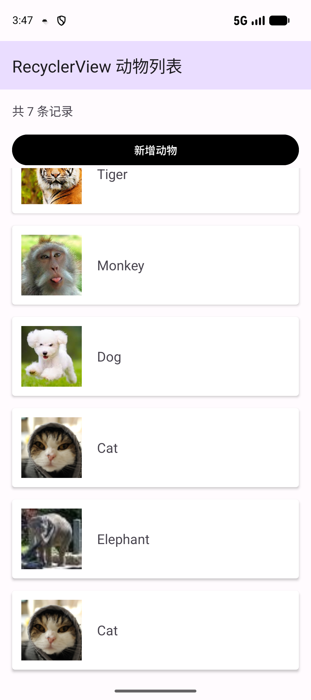 |

### 6.6 结果

| 图 25：点击新增 Cat 卡片后显示 Cat Toast | 图 26：滚回顶部 |
| --- | --- |
| 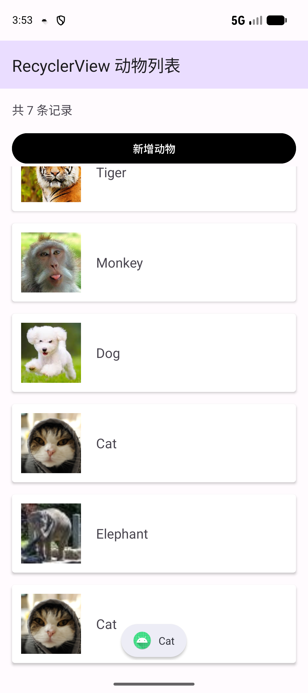 |  |

## 七、实现过程中遇到的问题与处理

| 问题 | 原因与处理 |
| --- | --- |
| 多选删除后下标偏移 | 从前向后删除会改变剩余元素下标；改为按原下标倒序删除 |
| ActionMode 重建后标题空白 | 恢复选择状态时不一定走勾选变化回调；在 onCreateActionMode 中也设置标题 |
| 上下文栏下出现重复标题栏 | ActionMode 顶栏出现时普通 Toolbar 仍存在；创建时隐藏、销毁时恢复 |
| 删除图标在浅色背景上不清楚 | 固定白色图标缺少主题着色；使用 colorControlNormal |
| 菜单 XML 的 lint 错误 | AppCompat 菜单误用 android:showAsAction；改为 app:showAsAction |
| 复用或插入后点击对象可能错误 | 如果监听器固定旧位置，可能读取错误记录；点击时读取 bindingAdapterPosition 并判断 NO_POSITION |
